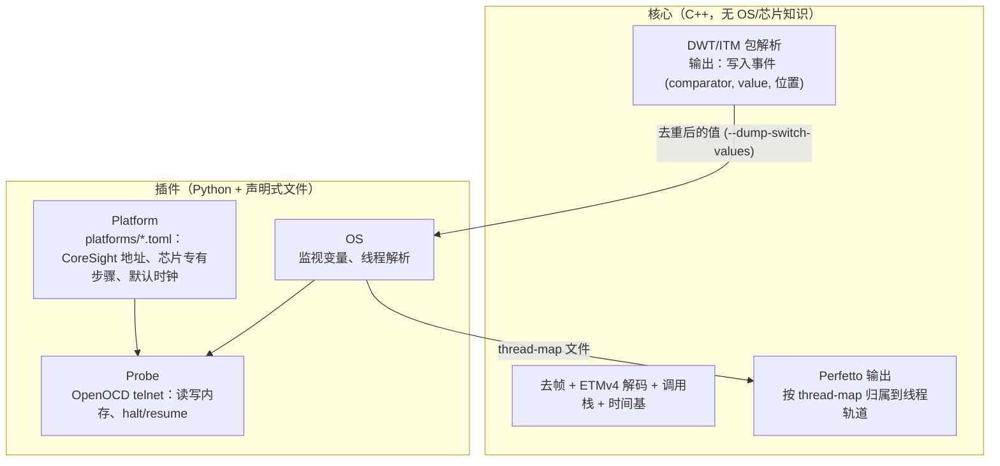

# Cortrace 扩展性设计：芯片 / OS / 探针 三类插件

状态：第 1、2、3、5 步已实现并在板上验证（NuttX/Vela 与 FreeRTOS，均在 STM32H743 上），第 4 步（探针抽象）和 note 格式参数化尚未做。第 9 节记录了每一步的验证结果。

## 1. 目标与非目标

目标：

- 核心引擎（去帧、ETMv4 解码、调用栈、时间基、Perfetto 输出）不出现任何具体 OS 或芯片的名字。
- 新增一个 OS 或一款芯片，只加文件，不改核心。
- NuttX 上游和 Vela 的差异（TCB 偏移）由插件从 ELF 的 DWARF 读出，不再靠命令行手填。

非目标：

- 不做通用的 CoreSight 虚拟机或脚本引擎。
- 不抽象 CPU 架构。目前只有 Armv7-M 一种，等出现第二种再说。
- 不替换 OpenOCD。探针层先只有 OpenOCD 一个实现。

## 2. 原先的耦合点

| 位置 | 耦合内容 | 属于 | 现状 |
|---|---|---|---|
| `NuttxResolver`（C++） | TCB 的 pid/entry 偏移默认 0x30/0x3C | OS | 解码器只读 thread-map；旧选项保留为已弃用 |
| `--nx-tcb-pid-off` 等 | Vela 是 0x34/0x44，每次手填 | OS | NuttX 插件从 DWARF 读 |
| `tcbmap.py` | `g_pidhash`、H7 SRAM 地址范围 | OS + 芯片 | 保留为旧命令；插件通过探针读活内存取代它 |
| `nxtrace_dap.cfg`（cortrace-fpga） | H743 的 CoreSight 地址、GPIOE 复用、SYSCFG、`g_running_tasks` | 芯片 + OS | `platforms/stm32h743.toml` + `cortrace arm` 取代；cfg 仍保留 |
| `DEFAULT_TSGEN_HZ` | 75 MHz | 板子 | 平台文件的 `[clocks]` 里有默认值，`capture` 尚未读取 |
| `unwrap_note_systime` | NuttX note 帧格式 | OS | **未改**，仍在解码器里 |
| `--itm-note-port` 默认 1 | 上游 NuttX 的端口 | OS | **未改**，`capture --itm-port` 手填 |

FPGA 抓包这一段只看管脚电平，与芯片和 OS 都无关。

## 3. 参考设计

TRACE32 和 SEGGER J-Link/Ozone 的做法有三点值得借用：

- **CoreSight 部分声明式描述，芯片专有部分才写脚本。** J-Link 自动检测并初始化 CoreSight 组件，用户只在 `OnTraceStart()` 里配管脚、时钟、`DBGMCU_CR` 这类芯片寄存器。TRACE32 用 `SYStem.CONFIG.<组件>.Base` 与 `ATBSource` 描述拓扑，也支持读 ROM 表发现组件。
- **OS 感知独立于核心。** TRACE32 用 `TASK.CONFIG nuttx.t32` 加载，Ozone 用 `Project.SetOSPlugin("<file>")` 加载 JavaScript 插件。
- **线程切换 trace 的机制是通用的。** TRACE32 手册里的做法是对"当前任务变量"的写入产生 trace 包（`Break.Set TASK.CONFIG(magic) /Write /TraceData`），OS 只需要告诉调试器这个变量在哪。这与我们用 DWT 比较器监视 `g_running_tasks` 是同一机制。

出处：TRACE32 手册 `trace32_concepts.pdf`（OS-aware Tracing）、`app_arm_coresight.pdf`、`rtos_nuttx.pdf`；SEGGER 的 [J-Link script files](https://kb.segger.com/J-Link_script_files)、[trace 配置](https://kb.segger.com/How_to_configure_JLinkScript_files_to_enable_tracing)、[RTOS 感知](https://www.segger.com/products/development-tools/ozone-j-link-debugger/technology/rtos-awareness/)。

## 4. 分层



核心只认三种输入：字节流、ELF、一个 thread-map 文件。其余全部由插件在核心之外准备。

## 5. 插件契约（已实现的形态）

### 5.1 Platform（芯片 / 板）

`platforms/<名字>.toml`，由 `cortrace/platdesc.py` 加载，`cortrace/trace_arm.py` 执行。查找顺序：`$CORTRACE_PLATFORM_PATH`、`~/.config/cortrace/platforms`、`/usr/share/cortrace/platforms`、源码树的 `platforms/`。

- `[coresight]`：ETM、DWT、ITM、CSTF、ETF、TPIU、TSGEN 的基地址（全部必填）。
- `[trace]`：ETM 与 ITM/DWT 的 trace id、最大端口宽度。
- `[clocks]`：板级默认时钟，目前只是记录。
- `[[on_trace_start]]`：芯片专有步骤，三种操作：`write32`、`rmw32`（`set`/`clear`）、`poll32`（`mask`、`tries`，默认超时只打印提示并继续，`required = true` 才报错）。

所有 Armv7-M 通用的部分（解锁、TPIU/漏斗/ETF/ETM/ITM/DWT 的编程顺序）写在 `trace_arm.py` 里，不放进平台文件。`stm32h743.toml` 是 `nxtrace_dap.cfg` 里芯片专有那部分的直译：SYSCFG 补偿单元、GPIOE 复用、`DBGMCU_CR`。

没有做的：ROM 表自动发现，`python = "module:function"` 形式的复杂钩子。

### 5.2 Probe

`probe.OpenOcdTelnet` 连接一个已在运行的 OpenOCD：`read32`、`write32`、`read_bytes`、`halt`、`resume`。OpenOCD 返回错误时抛 `ProbeError`。不另起 OpenOCD，因为再连一次会清掉 DWT 配置。

接口还没有抽出成基类，因为只有这一个实现。

### 5.3 OS 插件

```python
class OsPlugin:
    name: str
    def detect(self, elf) -> bool: ...           # 按符号判断，用于 --os auto
    def watch(self, elf) -> list[Watch]: ...     # 要让 DWT 监视的变量
    def resolve(self, values, mem, elf) -> dict[int, ThreadInfo]: ...
```

- `Memory` 先读活目标（探针），读不到再读 ELF 里的初始镜像。FreeRTOS 的 TCB 在 `.bss` 或堆里，ELF 里没有内容，所以活内存是主路径；先读活内存也能避开 `.data` 里被运行时改过的值。
- 结构偏移从 ELF 的 DWARF 读（`ElfInfo.struct_layout`）。DWARF 4 起是常量，DWARF 2/3 是 `DW_OP_plus_uconst` 表达式，两种都支持；这个固件用 `-gdwarf-2`。
- 解析不让 C++ 回调 Python，走文件交接：`cortrace-decode --dump-switch-values` 只做去帧和 DWT 解析，写出去重后的指针值；插件批量解析并写 thread-map；完整解码带 `--thread-map`。`cortrace capture` 自动完成这三步。
- 内置 `nuttx`、`freertos`。用户插件放 `$CORTRACE_PLUGIN_PATH` 或 `~/.config/cortrace/plugins/*.py`，模块里定义 `PLUGIN`；同名时用户的优先。

没有做的：`note_format()`。NuttX note 的帧格式仍写在解码器的 `unwrap_note_systime` 里。

### 5.4 命令

| 命令 | 作用 |
|---|---|
| `cortrace arm --platform P --elf ELF --probe-telnet HOST:PORT` | halt，按平台文件和 OS 插件给出的监视变量编程 trace 硬件，resume |
| `cortrace os list / watch / resolve` | 列插件、打印要监视的变量、从值文件生成 thread-map |
| `cortrace capture --os auto --probe-telnet HOST:PORT ...` | 抓取、解析线程名、解码 |

## 6. 对核心的改动

| 改动 | 状态 |
|---|---|
| 解码器读 thread-map，不再内置 NuttX 查找 | 已做（`--thread-map`；旧的 `--nx-tcbmap` 与偏移选项保留，标为弃用） |
| `--nx-switch-stream` / `--nx-comp` / `--nx-runs-out` 改名 | 已做（`--switch-stream` / `--watch-comp` / `--runs-out`，旧名为别名） |
| 相邻相同写入值折叠 | 已做 |
| `unwrap_note_systime` 按参数化的 note 格式工作 | 未做 |

调用栈、时间基、去帧、OpenCSD 适配、Perfetto 写出都没有动。

## 7. 验证设计：加入 FreeRTOS

用 FreeRTOS 验证"只加文件"这个声称。

### 7.1 要加的东西

- `python/cortrace/osplugins/freertos.py`，约 60 行。
- 没有新增芯片文件（沿用 `stm32h743.toml`），核心里只有一处通用改动（相邻相同值折叠）。

### 7.2 FreeRTOS 与 NuttX 的差异

| 项 | NuttX | FreeRTOS |
|---|---|---|
| 监视变量 | `g_running_tasks` | `pxCurrentTCB`；SMP 构建里是 `pxCurrentTCBs[]`，每个核心占一个比较器 |
| 线程名 | 由 `entry` 反查函数符号 | TCB 里的内联数组 `pcTaskName` |
| 线程 id | `pid` | `uxTCBNumber`（需 `configUSE_TRACE_FACILITY`），否则按指针顺序编号 |
| TCB 所在 | 多在堆里，静态的在数据段 | `.bss` 或堆，ELF 里没有内容 |
| 软件 note 流 | 有 | 没有标准格式 |

### 7.3 推演暴露出的两处核心问题

1. **只读 ELF 镜像不够。** 旧的 `NuttxResolver` 能解析静态 TCB，是因为 NuttX 的静态 TCB 初始化过。FreeRTOS 的名字是运行时写进 `.bss` 的，所以必须读活内存。
2. **相邻相同值要折叠。** 旧的 `build_thread_runs` 对每个 DWT 事件都开新 run。当调度器重新选中同一个任务时（比如任务调用 `taskYIELD()` 而没有别的任务就绪），内核仍会写 `pxCurrentTCB`，值不变，这不是线程切换。

第 2 点最初的推演写成"FreeRTOS 每次调度都会重写"，板上实测并不成立：演示固件里不做 `taskYIELD()` 时，DWT 事件数与 run 数完全相等（1236 对 1236），没有重复写入。只有在显式 `taskYIELD()` 时才出现。折叠仍然需要，只是触发条件比推演的窄。

### 7.4 另外两个案例

- **Vela 与上游 NuttX**：同一个 NuttX 插件，偏移从各自 ELF 的 DWARF 读（上游 48/60，Vela 52/68，已在两个 ELF 上核对）。
- **同系列的另一颗 Cortex-M7**：只需一个 `platforms/<chip>.toml`；OS 插件和核心都不动。这一条没有实测，板子只有 H743。

## 8. 迁移计划与进度

1. OS 插件 + DWARF 偏移 + thread-map：完成。
2. 相邻相同值折叠：完成。
3. Platform TOML：完成，`cortrace arm` 取代 `nxtrace_dap.cfg` 的功能。`capture` 还不读 `[clocks]`。
4. Probe 基类抽象：等出现第二种探针再做。
5. FreeRTOS 插件与板上验证：完成。

旧命令行选项至少保留一个版本。

## 9. 板上验证结果

| 场景 | 结果 |
|---|---|
| Vela NuttX，`cortrace arm` 从空白状态（先手工关掉 DWT/ITM/ETM）布防，`capture --notes`，`nxtrace merge` | 9680/9680 切换按顺序配对，残差 sd 0.515 µs；此前用 Tcl 配置的同类抓取是 9678/9678，0.492 µs |
| FreeRTOS，纯 OpenOCD（无 Tcl）+ `cortrace arm` + `cortrace capture` | 4/4 指针解析出 `sensor`/`worker`/`calc`/`blink`；ETM 流 clean，262 万次调用 begin/end 配平；`blink` 10 次/秒、`sensor` 200 次/秒（5 ms 周期）、`worker`/`calc` 约 1 ms 一段（同优先级时间片轮转） |
| 重复写入折叠 | 1436 个 DWT 事件折叠成 1236 个 run，差值正好是 `sensor` 每秒 200 次 `taskYIELD()` |

实测发现并修掉的两个真实问题：

- 固件用 `-gdwarf-2`，成员偏移是表达式而不是常量，起初解析出的偏移全错，所有线程都解析不出来。
- **调用栈机原本只有一个栈，所有线程共用。** 线程在 `xTaskDelayUntil` 里被切走时，它的栈帧还开着，下一个线程的返回会把这些帧弹掉，或者被它们压住，于是 `sensor` 泳道里的 `xTaskDelayUntil` 一层层叠到 65 层，`worker` 到 289 层。现在 DWT 的切换事件在解码时就交给调用栈机，每个线程一个栈（`switch_thread`）；切换发生在 PendSV 里时立即生效，因为 ISR 的栈本来就是独立的。修好后 `sensor` 最深 2 层，`xTaskDelayUntil` 每次约 4.98 ms，正好是 5 ms 周期。线程切换事件与 ETM 字节的相对位置有偏差的话，切换点会偏几条指令，目前没看到影响。
- **直接递归被压平。** 调用栈机把"要压入的函数等于栈顶"一律当成"上一次的返回丢了"，真正的递归（演示固件里的 `calc_sum`，最深 8 层）只剩 1 层，还产生了约 98.6 万次"补救"和 98.9 万次返回不匹配。现在只有在该栈帧压入之后 trace 出现过断点（同步丢失、地址不可达）时才这样处理，没有断点的递归按真实栈保留。修好后 `calc` 最深 8 层，返回不匹配降到 2625，补救为 0。代价是：断点之前压入的递归帧，在断点之后再递归进入同一函数时仍会被当成丢了返回。

## 10. 未决问题

- thread-map 格式要不要加版本号和 OS 名，避免错配。
- 多核 SMP 下 `watch()` 返回多个变量时，轨道命名与排序规则；`--watch-comp` 目前只处理一个比较器。
- `capture` 读取平台文件的 `[clocks]`，替代 `--tsgen-hz` / `--sysclk-hz` 的手填。
- ROM 表发现与手写 `[coresight]` 冲突时以谁为准，倾向于以手写为准并打印差异。
- `note_format()` 要不要做：需要给解码器一个描述帧长、时间戳偏移、位宽的选项。

## 11. 资料

- TRACE32 手册：`trace32_concepts.pdf`（第 36 到 44 页）、`app_arm_coresight.pdf`、`rtos_nuttx.pdf`、`trace_arm_etm.pdf`。
- SEGGER：[J-Link script files](https://kb.segger.com/J-Link_script_files)、[trace 配置](https://kb.segger.com/How_to_configure_JLinkScript_files_to_enable_tracing)、[Ozone RTOS 感知](https://www.segger.com/products/development-tools/ozone-j-link-debugger/technology/rtos-awareness/)。
- FreeRTOS：[`pxCurrentTCBs` 在 SMP 下的说明](https://forums.freertos.org/t/pxcurrenttcb-cannot-be-referenced-outside-tasks-c-when-confignumber-of-cores-1/21957)。
- OpenOCD 的 `src/rtos/` 与 pyOCD 的 target/CoreSight 发现代码，可作实现参考。
