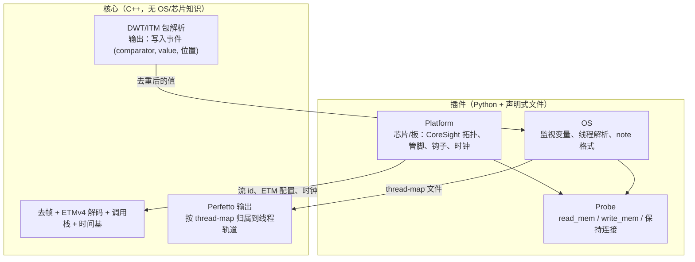

# Cortrace 扩展性设计：芯片 / OS / 探针 三类插件

状态：设计草案，尚未实现。文中涉及 FreeRTOS 的部分只是纸面推演，没有在板子上验证过。

## 1. 目标与非目标

目标：

- 核心引擎（去帧、ETMv4 解码、调用栈、时间基、Perfetto 输出）不出现任何具体 OS 或芯片的名字。
- 新增一个 OS 或一款芯片，只加文件，不改核心。
- NuttX 上游和 Vela 的差异（TCB 偏移、note 类型号、ITM 端口）由插件消化，不再靠命令行手填。

非目标：

- 不做通用的 CoreSight 虚拟机或脚本引擎。
- 不抽象 CPU 架构。目前只有 Armv7-M 一种，等出现第二种再说。
- 不替换 OpenOCD。探针层先只有 OpenOCD 一个实现。

## 2. 现状：耦合在哪里

| 位置 | 耦合内容 | 属于 |
|---|---|---|
| `nxtrace.hpp/cpp` 的 `NuttxResolver` | TCB 的 pid/entry 偏移默认 0x30/0x3C，从 ELF 镜像读 | OS |
| `--nx-tcb-pid-off`、`--nx-tcb-entry-off` | 上面偏移的命令行覆盖。Vela 是 0x34/0x44，每次手填 | OS |
| `unwrap_note_systime` | 按 NuttX note 帧格式解析（16 字节头、`type > 40`、`+8` 处 u64 systime） | OS |
| `--itm-note-port` 默认 1 | 上游 `ARMV7M_NOTE_ITM_PORT`；Vela 是 0 | OS |
| `tcbmap.py` | `g_pidhash`、TCB 指针范围 `0x20000000..0x40000000`（H7 的 SRAM） | OS + 芯片 |
| `nxtrace_dap.cfg`（cortrace-fpga） | H743 的 TPIU/CSTF/ETF/ETM/TSGEN/DBGMCU 地址、GPIOE 复用、SYSCFG 补偿单元、`g_running_tasks` | 芯片 + OS |
| `capture.py` 的 `DEFAULT_TSGEN_HZ` | 75 MHz，是 H7 当前板子的 HCLK | 板子 |
| `EtmV4Config` 默认值 | Cortex-M7 的 IDR 寄存器值 | 芯片 |
| 流 id（ETM=2，DWT/ITM=1） | TPIU 配置决定 | 芯片 |
| 各脚本里的 `stm32h7x.cfg` | OpenOCD 目标 | 芯片 + 探针 |

FPGA 抓包这一段只看管脚电平，与芯片和 OS 都无关，不在这张表里。

## 3. 参考设计

TRACE32 和 SEGGER J-Link/Ozone 的做法有三点值得借用：

- **CoreSight 部分声明式描述，芯片专有部分才写脚本。** J-Link 自动检测并初始化 CoreSight 组件，用户只在 `OnTraceStart()` 里配管脚、时钟、`DBGMCU_CR` 这类芯片寄存器。TRACE32 用 `SYStem.CONFIG.<组件>.Base` 与 `ATBSource` 描述拓扑，也支持读 ROM 表发现组件。
- **OS 感知独立于核心。** TRACE32 用 `TASK.CONFIG nuttx.t32` 加载，Ozone 用 `Project.SetOSPlugin("<file>")` 加载 JavaScript 插件。
- **线程切换 trace 的机制是通用的。** TRACE32 手册里的做法是对"当前任务变量"的写入产生 trace 包（`Break.Set TASK.CONFIG(magic) /Write /TraceData`），OS 只需要告诉调试器这个变量在哪。这与我们用 DWT 比较器监视 `g_running_tasks` 是同一机制。

出处：本机 `~/tools/t32/pdf/trace32_concepts.pdf`（OS-aware Tracing）、`app_arm_coresight.pdf`、`rtos_nuttx.pdf`；SEGGER 的 [J-Link script files](https://kb.segger.com/J-Link_script_files)、[trace 配置](https://kb.segger.com/How_to_configure_JLinkScript_files_to_enable_tracing)、[RTOS 感知](https://www.segger.com/products/development-tools/ozone-j-link-debugger/technology/rtos-awareness/)。

## 4. 分层



核心只认三种输入：字节流、ELF、一个 thread-map 文件。其余全部由插件在核心之外准备。

## 5. 插件契约

### 5.1 Platform（芯片 / 板）

一个 TOML 文件，分两段：通用 CoreSight 与芯片专有。板子相关的值（时钟）放在可覆盖的 `[clocks]`，因为同一颗芯片在不同板上频率不同。

```toml
# platforms/stm32h743.toml
name = "stm32h743"
core = "cortex-m7"

[coresight]                 # 通用部分：拓扑，等价于 TRACE32 的 SYStem.CONFIG
etm   = 0xE0041000
dwt   = 0xE0001000
itm   = 0xE0000000
cstf  = 0x5C013000
etf   = 0x5C014000
tpiu  = 0x5C015000
tsgen = 0x5C005000
atb   = [ { src = "etm", id = 2 }, { src = "itm", id = 1 }, { src = "dwt", id = 1 } ]
tpiu_width = 4

[etm]                       # 来自 TRCIDRn，替换 EtmV4Config 里的 M7 默认值
idr0 = 0x080006e1
idr1 = 0x4100f401
# ...

[clocks]                    # 板级默认值，可被命令行覆盖
tsgen_hz  = 75000000
sysclk_hz = 150000000

# 芯片专有：只有这里是"脚本"，等价于 J-Link 的 OnTraceStart()
[[on_trace_start]]
op = "rmw32"; addr = 0x580244E0; set = 0x10       # RCC_AHB4ENR.GPIOEEN
[[on_trace_start]]
op = "rmw32"; addr = 0x58000420; set = 0x1        # SYSCFG 补偿单元
[[on_trace_start]]
op = "write32"; addr = 0x5C001004; value = 0x00100020   # DBGMCU_CR
# ...
```

钩子优先用声明式操作（`write32`、`rmw32`、`wait_us`），覆盖绝大多数芯片。超出表达力时允许 `python = "module:function"`，函数拿到 probe 对象。这样 `nxtrace_dap.cfg` 里的 Tcl 可以逐段迁移成 TOML，不再绑死 OpenOCD。

可选：`discover = true` 让工具读 ROM 表，用发现结果核对或补全 `[coresight]`，与 TRACE32 的做法一致。

### 5.2 Probe

最小接口，只有实际用到的几个动作：

```python
class Probe:
    def read32(self, addr: int, count: int = 1) -> list[int]: ...
    def write32(self, addr: int, value: int) -> None: ...
    def read_bytes(self, addr: int, n: int) -> bytes: ...
    def keep_attached(self) -> None: ...   # 保持连接，否则 DWT 配置会被清掉
```

第一个实现是 OpenOCD telnet（现有 `tcbmap.py` 里已有这套读法）。`keep_attached` 对应 AGENT.md 里记录的约束：抓 DWT 线程 trace 时不能另起 openocd。

### 5.3 OS 插件

```python
class OsPlugin:
    name: str

    def detect(self, elf) -> bool:
        """按符号判断这个 ELF 是不是该 OS，用于 --os auto。"""

    def watch(self, elf) -> list[Watch]:
        """要让 DWT 监视的变量：[Watch(symbol, addr, size)]。"""

    def resolve(self, values: set[int], mem: MemReader, elf) -> dict[int, ThreadInfo]:
        """把 DWT 抓到的指针值批量解析成线程身份。"""

    def note_format(self) -> NoteFormat | None:
        """可选：软件 note 流的帧格式，用于回绕展开。没有就返回 None。"""
```

- `MemReader` 先查 ELF 镜像，查不到再走 probe 读活内存。插件不关心数据从哪来。
- 结构偏移一律从 ELF 的 DWARF 读（`struct tcb_s` 的 `pid`、`entry`），不再靠命令行。这直接消掉 Vela 与上游的偏移差异。没有调试信息时报错并提示，不猜。
- `ThreadInfo` 只有 `tid`、`name` 两个必填字段，其余放 `extra`，由核心原样写进 Perfetto 的参数。

线程解析不让 C++ 回调 Python，走文件交接：

1. 解码器加一个 `--dump-switch-values FILE`：只做去帧和 DWT 解析，写出去重后的写入值，不跑 ETM 解码，很快。
2. 插件读取这个文件，批量解析，写出 thread-map（沿用现在的 `tcbmap` 文件格式）。
3. 完整解码带 `--thread-map FILE` 再跑一遍。

### 5.4 发现与加载

- 内置插件随 deb 安装在 `/usr/lib/cortrace/plugins/`。
- 用户插件放 `~/.config/cortrace/plugins/`，同名时用户的优先。
- OS 插件是 Python 模块，Platform 是 TOML。清单文件 `plugin.toml` 写名字、类型、入口。
- CLI：`cortrace capture --platform stm32h743 --os auto`。`--os auto` 逐个插件 `detect`，多个命中或都不命中时报错，不猜。

## 6. 对核心的改动

| 改动 | 说明 |
|---|---|
| 去掉 `NuttxResolver`，改读 thread-map | 核心里不再有 pid/entry 偏移 |
| `--nx-*` 改名为 `--watch-*` / `--thread-map` | 旧名字保留一个版本作别名并打印弃用提示 |
| 相邻相同写入值折叠 | 见 7.3，FreeRTOS 暴露出来的 |
| `unwrap_note_systime` 改为按 `NoteFormat` 参数化 | 帧长、时间戳偏移、位宽、类型上限由插件给出 |
| `--itm-note-port` 默认值由 Platform 或 OS 插件给出 | 不再硬编码 1 |

调用栈、时间基、去帧、OpenCSD 适配、Perfetto 写出都不动。

## 7. 验证设计：加入 FreeRTOS

用 FreeRTOS 验证"只加文件"这个声称。下面是逐项推演。

### 7.1 要加的东西

```
plugins/os/freertos/plugin.toml
plugins/os/freertos/freertos.py      # 约 100 行
```

不新增芯片文件（沿用 `stm32h743.toml`），也不改核心。

### 7.2 FreeRTOS 与 NuttX 的差异

| 项 | NuttX | FreeRTOS |
|---|---|---|
| 监视变量 | `g_running_tasks`（数组，按 CPU） | `pxCurrentTCB`；SMP 构建里叫 `pxCurrentTCBs[]` |
| 变量内容 | 指向 TCB 的指针 | 指向 TCB 的指针 |
| 线程名 | 从 `entry` 地址反查函数符号，或 TCB 里的 name | TCB 里的内联数组 `pcTaskName` |
| 线程 id | `pid` | `uxTCBNumber`（需 `configUSE_TRACE_FACILITY`），否则由核心按指针顺序编号 |
| TCB 所在 | 静态 TCB 在 ELF 数据段，有机会直接从镜像读 | 在 `.bss` 或堆里，ELF 镜像里没有内容 |
| 软件 note 流 | 有（NuttX note，经 ITM） | 没有标准格式 |

对应到接口：

- `watch()` 返回 `pxCurrentTCB`；若 ELF 里只有 `pxCurrentTCBs`，返回数组每个元素，各占一个 DWT 比较器。DWT 最多 4 个比较器，核数超过会明确报错。
- `resolve()` 用 DWARF 找 TCB 结构（FreeRTOS 里叫 `tskTCB`，别名 `TCB_t`）里 `pcTaskName` 的偏移和数组长度，用 `MemReader` 读字符串；`uxTCBNumber` 存在就读，不存在就不填 `tid`，交给核心编号。
- `note_format()` 返回 `None`。这条路径完全可选：没有 note 就没有 `notes_<tag>.bin`，只产出硬件 trace，这本来就是 cortrace 的定位。

### 7.3 推演暴露出的两处核心问题

这两点是 NuttX 一种 OS 时看不出来的，也是写这一节的价值：

1. **只读 ELF 镜像不够。** 现在的 `NuttxResolver` 能解析静态 TCB，是因为 NuttX 的静态 TCB 初始化过，落在 ELF 的数据段。FreeRTOS 的 TCB 在 `.bss`，名字是运行时写进去的，ELF 里没有。所以 `MemReader` 的"走 probe 读活内存"不是可选项，对 FreeRTOS 是主路径。活内存要在抓取之后尽快读，任务被删除后 TCB 会被复用，这一点 NuttX 的 `tcbmap` 已经有同样的限制。
2. **相邻相同值要折叠。** 读 `build_thread_runs` 的结果是：它对每个 DWT 事件都开一个新 run，不判断值是否和上一个相同。FreeRTOS 的 `vTaskSwitchContext` 每次选任务都会给 `pxCurrentTCB` 赋值，包括选中的还是同一个任务。这会产生一串相同值的写入，在时间线上变成碎片化的零宽 run。这个折叠放在核心里统一做，对所有 OS 都成立，也对 NuttX 无害。

第二点只是从代码和 FreeRTOS 行为推出来的，还没有在板上抓过，需要实测确认。

### 7.4 结论

FreeRTOS 需要新增两个文件，核心里只有"折叠相邻相同值"这一处小改动，且它是通用的，不是为 FreeRTOS 特判。接口本身（`watch` / `resolve` / `note_format`）不需要改。

### 7.5 另外两个案例

- **Vela 与上游 NuttX**：同一个 NuttX 插件，偏移从各自 ELF 的 DWARF 读，`NOTE_RESUME` 类型号同样从 DWARF 读，ITM 端口放 Platform。`--nx-tcb-*-off`、`--itm-port`、`--resume-type` 这三个手填项全部消失。
- **同系列的另一颗 Cortex-M7**：只加一个 `platforms/<chip>.toml`，改地址和 `on_trace_start`。OS 插件和核心都不动。

## 8. 迁移计划

1. **OS 插件 + DWARF 偏移 + thread-map。** 解码器加 `--dump-switch-values` 与 `--thread-map`，NuttX 插件落地，`--nx-*` 保留为别名。验收：Vela 板上不手填偏移，抓到的线程切换与现在一致（7559/7559，同样的偏移）。
2. **相邻相同值折叠。** 独立小提交，加单元测试。
3. **Platform TOML。** 先把 `nxtrace_dap.cfg` 里的地址和 `DEFAULT_TSGEN_HZ` 搬进 `stm32h743.toml`，由 Python 通过 Probe 执行钩子，对照 `nxtrace_dap.cfg` 的寄存器写入顺序做回归。
4. **Probe 抽象。** 等出现第二种探针再做。
5. **FreeRTOS 插件。** 作为对 5.3 接口的实测，需要一块跑 FreeRTOS 的板子，现有 H743 板子刷 FreeRTOS 即可。

每一步都保持旧命令行可用至少一个版本。

## 9. 未决问题

- `python = "module:function"` 钩子的安全边界：用户插件等同于执行任意代码，需要在文档里写明，不做沙箱。
- thread-map 格式要不要加版本号和 OS 名，避免错配。
- 多核 SMP（比如 FreeRTOS SMP 或 NuttX SMP）下 `watch()` 返回多个变量时，轨道命名与排序规则。
- DWARF 读取用 `pyelftools` 还是调 `readelf`。nxtrace 已经用 pyelftools（`nxtrace/trace.py` 里读 note 结构），复用它最省事，但 cortrace 的 deb 目前没有这个 Python 依赖，需要加。大 ELF 上 pyelftools 解析 DWARF 的内存开销也要实测（nxtrace 里有一处注释提到过约 1 GB）。
- ROM 表发现与手写 `[coresight]` 冲突时以谁为准，倾向于以手写为准并打印差异。

## 10. 资料

- 本机：`~/tools/t32/pdf/trace32_concepts.pdf`（第 36 到 44 页）、`app_arm_coresight.pdf`、`rtos_nuttx.pdf`、`trace_arm_etm.pdf`。
- SEGGER：[J-Link script files](https://kb.segger.com/J-Link_script_files)、[trace 配置](https://kb.segger.com/How_to_configure_JLinkScript_files_to_enable_tracing)、[Ozone RTOS 感知](https://www.segger.com/products/development-tools/ozone-j-link-debugger/technology/rtos-awareness/)。
- FreeRTOS：[`pxCurrentTCBs` 在 SMP 下的说明](https://forums.freertos.org/t/pxcurrenttcb-cannot-be-referenced-outside-tasks-c-when-confignumber-of-cores-1/21957)。
- OpenOCD 的 `src/rtos/` 与 pyOCD 的 target/CoreSight 发现代码，可作实现参考。
