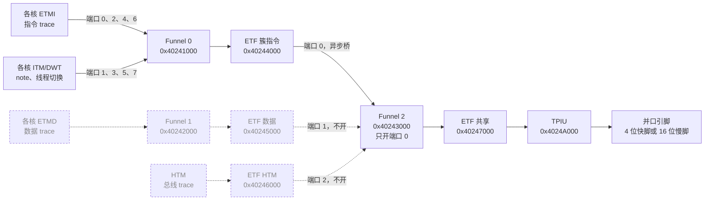

# S32K3xx 系列的并口 trace 适配分析

状态：`platforms/s32k344.toml` 是**草稿，没有上过板**。本文只依据公开资料，按整个 S32K3xx 系列分析，记录每个数字来自手册的哪里，哪些只有上板才能确认。

资料：

- RM：S32K3xx Reference Manual，Rev. 12，2025-11-11。
- DS：S32K3xx Data Sheet，Rev. 14，2026-04-10，以及它内嵌的 `S32K3xx_part_number_dashboard.xlsx`。
- IOMUX：RM 内嵌的 7 个引脚复用工作簿（K310/K311、K312、K342/K341/K322、K344/K324/K314、K358/K356/K348/K338/K328、K388、K389）和 `S32K3xx_memory_map.xlsx`。

页码是页面上印的页码。PDF 转文字后表格和框图会错位，凡是决定性的数字都对着页面图核对过，下面标注"看图"的就是这种。

## 1. 结论

1. 这个系列分三层，**能不能用我们的系统，先看型号属于哪一层**：

   | 层 | 型号 | 有什么 | 我们的系统 |
   |---|---|---|---|
   | 0 | K310、K311、K312、K322、K341、K342 | 只有 ITM 经 SWO，**没有 ETM，没有 TPIU，没有并口 trace 引脚** | 用不了。我们抓的是并口 TPIU，SWO 是另一种接口 |
   | 1 | K314、K324、K344 | ETM（核 M7_0，K324 另有 M7_1）、TPIU、4 位快引脚、257 BGA 另有 16 位慢引脚。核频 160 MHz | 可用，板子要引出 4 位快引脚 |
   | 2 | K328、K338、K348、K356、K358 | 2 到 3 个核带 ETM、TPIU，快引脚有两组，289 BGA 另有 16 位慢引脚。核频 240 MHz | 可用，一次最多同时抓 2 个核 |
   | 3 | K388、K389 | 4 个 M7，ETF 加到 4 KB，trace 时钟到 125 MHz，289 BGA 或 437 BGA | 可用，但 4 个核一起抓需要 124 MB/s，我们的前端够不到，只抓 1 到 2 个核 |

2. 解码器不用改：所有型号的核都是 Cortex-M7，ETM 是同一个 ETM-M7，和 STM32H743 一样。要做的是平台文件（地址、漏斗端口、引脚和时钟的步骤）和每个型号的板子接线。
3. **时钟和数据的相位关系，文档不能确定**。DS 只给了一个很窄的数据有效窗口（1.2 ns，沿后保持 0.3 ns），没说数据是在两个沿的中间翻转，还是紧跟时钟沿翻转。我们的前端只收前者（见第 7 节）。所以下面的"可用"都以上板实测为前提。
4. 手册**自相矛盾**：RM 的两条注说快引脚和 ETM "只在 S32K344 上"，但 Table 824、Table 829、框图和 K358/K388/K389 的 IOMUX 都给了其他型号 ETM 和快引脚。这一点只有上板才能解决，见第 3 节。
5. NuttX 主线的 `arch/arm/src/s32k3xx` 只有 K314、K324、K344 的 `ARCH_CHIP_*` 选项，板子是 `s32k344evb` 和 `mr-canhubk3`；K328、K338 等在 Kconfig 里是注释掉的。第 2 层和第 3 层的型号需要先有 NuttX 的芯片支持。

## 2. 全系列对照

核数、核频、封装来自 DS 的 Figure 1 到 16 和型号仪表盘；ETM、TPIU 来自 RM Table 824（p.5298 到 5299，看图）；引脚来自各自的 IOMUX 工作簿。

| 型号 | 核 | 核频 | 带 ETM 的核 | TPIU / 漏斗 / ETF | 并口 trace 引脚（工作簿） | 封装 |
|---|---|---|---|---|---|---|
| K310、K311 | 单核 | 120 | 无（M7_0 只有 ITM） | 无 | 无 | 48 LQFP、100 HDQFP |
| K312 | 单核 | 120 | 无 | 无 | 无 | 100 LQFP、100 HDQFP、172 HDQFP |
| K322 | 双核 | 160 | 无（M7_0、M7_1 只有 ITM） | 无 | 无 | 100 HDQFP、172 HDQFP |
| K341、K342 | 锁步，调试时是 1 个核 | 160 | 无 | 无 | 无 | 100 HDQFP、172 HDQFP |
| K314 | 单核 | 160 | M7_0 | 有 | 与 K344 同一个工作簿 | 100 LQFP、172 HDQFP、257 BGA |
| K324 | 双核 | 160 | M7_0、M7_1 | 有 | 同上 | 同上 |
| K344 | 锁步，调试时是 1 个核 | 160 | M7_0 | 有 | 快脚 A 组；257 BGA 另有 16 位慢脚 | 100 LQFP、172 HDQFP、257 BGA |
| K328 | 双核 | 240 | M7_0、M7_1 | 有 | 快脚 A 组和 B 组；289 BGA 另有 16 位慢脚 | 172 HDQFP-EP、289 BGA |
| K338 | 三个独立核 | 240 | M7_0、M7_1、M7_2 | 有 | 同上 | 同上 |
| K348 | 锁步，调试时是 1 个核 | 240 | M7_0 | 有 | 同上 | 同上 |
| K356、K358 | 锁步加 1 个核 | 240 | M7_0、M7_2（M7_1 是锁步的检查核） | 有 | 同上 | 同上 |
| K388 | 1 锁步加 3 个核，或 2 锁步加 1 个核 | 320 | 4 个 M7 | 有，ETF 4 KB | 快脚 A 组和 B 组；289 BGA 另有 16 位慢脚 | 289 BGA |
| K389 | 同上 | 320（RM Table 832 写 300） | 同上 | 有，ETF 4 KB | 同上 | 437 BGA |

说明：

- "核"一栏里的锁步，是两个 M7 作一对，调试器只能看到其中一个，另一个是检查核。
- K328、K348 的 M7_2 在 Table 824 的合并单元格里看起来有，但 Figure 561 把 M7_2 标成"Not available on S32K328 and S32K348"，Table 835 也只给 K358、K338 列了 M7_2，所以以后两处为准。
- K389 的核频 DS 写 320 MHz，RM Table 832 的漏斗频率写 300 MHz，两处不一致，不影响判断。

## 3. 手册的矛盾，和我们怎么取舍

| 说"其他型号也有" | 说"只有 K344" |
|---|---|
| Table 824（p.5298 到 5299）：K324、K314、K338、K358、K348、K328、K388/K389 的 M7_0 有 ETM，且有 TPIU | RM p.5324，Table 840 下的注："ETM is supported in S32K344 only" |
| Table 829（p.5309 到 5311）：TPIU、漏斗、ETF 对这些型号都适用 | RM p.5323，Table 838 下的注："Fast Trace pad TRACE_D[15:0] is available only in S32K344" |
| 图 559 到 562（p.5313 到 5315）：K358 组、K388、K389 的 trace 架构图 | |
| K358 组、K388、K389 的 IOMUX 工作簿里有 `TRACE_ETM_*` 引脚和 `Trace` 页 | |
| DS Table 69（p.134）：并口 trace 时序对"除 K388/K389 外的所有型号"给出 120 MHz，对 K388/K389 给出 125 MHz | |

取舍：两条注的措辞是"16 位快引脚"和"ETM"，整个文档里别处都在给其他型号这些功能，所以更可能是那两条注没有跟着后来加的型号更新。但**这只是推测**，这几款到底能不能抓并口 trace，以第一次上板为准。K344 是两边都认可的型号，所以第 1 层里它最稳。

## 4. 数据路径

所有有 TPIU 的型号结构一样（RM 图 560 到 562，看图）：各核的 ETMI（指令 trace）和 ITM 进 Funnel 0，经簇 ETF 到 Funnel 2，再经共享 ETF 到 TPIU。ETMD（数据 trace）走 Funnel 1，HTM（总线 trace）走自己的 ETF，这两路都汇入 Funnel 2，我们不用。

实线是脚本编程并使能的部分，虚线是存在但不用的部分（数据 trace 会让 ETM 溢出，见 RM 82.7 的注）。ETF 放在硬件 FIFO 模式，TPIU 用连续的格式化器。

Funnel 0 的端口按核排列（RM Table 832，p.5316 到 5317）：

| 端口 | 输入 |
|---|---|
| 0 / 1 | Cortex-M7_0 的 ETMI / ITM |
| 2 / 3 | Cortex-M7_1 的 ETMI / ITM |
| 4 / 5 | Cortex-M7_2 的 ETMI / ITM（K358 组、K388、K389） |
| 6 / 7 | Cortex-M7_3 的 ETMI / ITM（K388、K389） |

Funnel 2 的端口 0 是"Cortex-M7 instruction ETF"，端口 1 是数据 ETF，端口 2 是 HTM ETF。**要抓哪个核，就在 Funnel 0 里开那个核的两个端口**（M7_0 用 0x03，M7_1 用 0x0C，M7_2 用 0x30，M7_3 用 0xC0），再用那个核的 AHB-AP 去读写它的 ETM、ITM、DWT。

### 地址

CoreSight 块的地址**整个系列相同**（RM Table 829，p.5309 到 5311，看图）：Funnel 0/1/2 在 0x40241000、0x40242000、0x40243000，簇 ETMI ETF 在 0x40244000，簇 ETMD ETF 在 0x40245000，HTM ETF 在 0x40246000，共享 ETF 在 0x40247000，HTM 在 0x40248000，TPIU 在 0x4024A000，时间戳发生器在 0x4024C000。各型号适用性是：K344、K324、K314、K358 组、K328、K388、K389 有 TPIU、3 个漏斗和 ETF；K342 等只有 Funnel 0 和 SWO。核内的 ITM、DWT、ETM 是 0xE0000000、0xE0001000、0xE0041000（RM Table 9，p.36），每个核从自己的 AHB-AP 看到的是同一个地址。

ETF 大小（RM Table 830，p.5312）：K388/K389 是簇 ETMI 4 KB、簇 ETMD 4 KB、HTM 2 KB、共享 4 KB；其他型号是 1 KB、2 KB、1 KB、2 KB。

### 调试口的 AP 编号

RM Table 826（p.5302 到 5303，看图）：

| AP | 对应 | 适用型号 |
|---|---|---|
| 1 | APB-AP（所有 4024xxxx 的块） | 全部 |
| 4 | Cortex-M7_0 的 AHB-AP | 全部 |
| 5 | Cortex-M7_1 的 AHB-AP | K344、K324、K322、K358、K388、K389 |
| 3 | Cortex-M7_2 的 AHB-AP | K358、K338、K388、K389 |
| 8 | Cortex-M7_3 的 AHB-AP | K388、K389 |
| 6 | MDM_AP | 全部 |

Table 826 的第 5 行没有列 K338 和 K328，但 Table 824 和 Table 835 都说它们有 M7_1。这是 RM 内部的不一致，上板时 M7_1 的 AP 要实测。OpenOCD 0.11.0 里没有 S32K3 的 target 配置，需要自己写，`-ap-num` 写对应核的 AP 号。

## 5. 引脚

这里只列和我们的 FPGA（4 位输入加时钟，LVCMOS33）相关的 4 位快引脚。完整数据在 IOMUX 工作簿的 `*_Pinout` 页，下面所有引脚号都和封装页互相对过。

快引脚都是 `GPIO-FAST`，电源域 **VDD_HV_B**。输出电平跟 VDD_HV_B，3.3 V 或 5 V（DS 范围 2.97 到 5.5 V）。IOMUX 的 `Trace` 页对这些引脚写的是 "Trace @ 3.3V"，我们的 FPGA 输入是 3.3 V，所以**目标板的 VDD_HV_B 要是 3.3 V**，否则要加电平转换。

引脚复用寄存器：SIUL2 基地址 0x40290000，MSCRn 在 0x240 + 4n（RM p.307）；SSS 在位 3 到 0，DSE 在位 8，SRC 在位 14（0 为最快），OBE 在位 21（RM p.425 到 427）。K344 组的工作簿只有 SSS[2:0]，K358 组之后是 SSS[3:0]，B 组用到 ALT11 到 ALT15，所以只在后者上存在。

### A 组（所有 TPIU 型号）

| 信号 | 端口 | ALT | MSCR 编号 | K344 组：100 LQFP / 172 HDQFP / 257 BGA | K358 组、K388：172 HDQFP-EP / 289 BGA | K389：437 BGA |
|---|---|---|---|---|---|---|
| TRACE_ETM_CLKOUT | PTC2 | 6 | 66 | 30 / 50 / T4 | 50 / T4 | V6 |
| TRACE_ETM_D0 | PTD7 | 6 | 103 | 31 / 51 / U4 | 51 / U4 | W6 |
| TRACE_ETM_D1 | PTD12 | 4 | 108 | 34 / 54 / R5 | 54 / R5 | U7 |
| TRACE_ETM_D2 | PTD11 | 4 | 107 | 35 / 55 / U6 | 55 / U6 | W8 |
| TRACE_ETM_D3 | PTD10 | 4 | 106 | 36 / 56 / T6 | 56 / T6 | V8 |

K388 只有 289 BGA（没有 172 脚），表里 K388 取 289 BGA 一栏。A 组的引脚和 EMAC/GMAC0 的 RMII、QuadSPI 复用，用了 trace 这些功能就不能用（IOMUX `Trace` 页："No ENET/QSPI 4bit available"）。

### B 组（K358 组、K388、K389 才有，和 QuadSPI 4 位共存）

| 信号 | 端口 | ALT | MSCR 编号 | 172 HDQFP-EP / 289 BGA（K358 组、K388） | 437 BGA（K389） |
|---|---|---|---|---|---|
| TRACE_ETM_CLKOUT | PTC1 | 12 | 65 | 61 / T8 | V10 |
| TRACE_ETM_D0 | PTC0 | 11 | 64 | 62 / U7 | W9 |
| TRACE_ETM_D1 | PTD9 | 15 | 105 | 63 / U8 | W10 |
| TRACE_ETM_D2 | PTD8 | 12 | 104 | 64 / R8 | U10 |
| TRACE_ETM_D3 | PTC17 | 13 | 81 | 65 / R6 | U8 |

K344 组的工作簿里没有 B 组。

### 16 位慢脚

只在大封装上：K344 组的 257 BGA，K358 组和 K388 的 289 BGA，K389 的 437 BGA。焊盘是 `GPIO-STANDARD-PLUS`，电源域 VDD_HV_A，ALT7。时钟最高 25 MHz，16 位共 100 MB/s。**我们的 FPGA 只接了 4 位**（`trace_data_in[3:0]`），用慢脚要改 RTL 和约束，本文不展开。

### SWO

所有型号的 SWO 都在 PTA10 的 ALT7（`JTAG_TDO/TRACEnoETM_SWO`），和并口 trace 无关。

## 6. 时钟

TRACE_CLK 由 MC_CGM 的 mux 11 产生（RM p.1098 到 1102，MC_CGM 基地址 0x402D8000）：MUX_11_CSC 在 +0x5C0，CSS 在 +0x5C4，DC_0 在 +0x5C8，DIV_UPD_STAT 在 +0x5FC。源 SELCTL：0000b FIRC，0010b FXOSC，1001b PLL_PHI1_CLK，1100b PLL_AUX_PHI0_CLK。它是**软件控制的 mux**，要按 RM 图 124（p.1011）的流程切：gate、等 CS=0、选源、解 gate、等 CS=1。分频器周期 = (DIV+1) × 输入周期，DC_0 必须一次原子写。上电默认源是 FIRC。

各层快引脚的 TRACE_CLK 设置（RM Table 153 到 157，p.973 到 983，看图）：

| 层 | 源和设置 | 手册给的 TRACE_CLK |
|---|---|---|
| 1（K344 组，核 160 MHz） | PLL_PHI1 为 240 MHz 时 DIV=0001b；为 160 MHz 时 DIV=0001b | 120 MHz、80 MHz |
| 2（K358 组，核 240 或 160 MHz） | PLL_PHI1 为 480 MHz（ODIV 0000b），DIV=0001b | 120 MHz（带脚注 3） |
| 3（K388/K389） | PLL_AUX_PHI0 为 250 MHz，SELCTL=1100b，DIV=0000b | 125 MHz（带脚注 4） |

脚注 3 和 4 的意思是："最终的时钟频率还要经过额外的分频级"（Table 157 的脚注 3，看图）。RM 的时钟图 66、67 在 `MUX_11_DC_0` 后面都画了一个 `/2`。第 2 层的数字只有用这个 `/2` 才对得上：480 / (1+1) / 2 = 120。所以第 2 层引脚时钟 = PHI1 / (DIV+1) / 2；这个公式在第 1 层 K344 上对不上（240 / 2 = 120，Table 157 却没有脚注 3），所以 K344 的引脚时钟到底是 120 还是 60 要量。

我们的采集前端实测的干净上限是引脚时钟约 75 MHz（见 cortrace-fpga），所以不要用手册的 120/125 MHz。所需的最低值见下一节。

## 7. 带宽

| 数字 | 出处 |
|---|---|
| 一个核的 ETM 指令 trace 需要 27.6 MB/s（K388/K389 是 31.06 MB/s） | RM Table 834、835（p.5318） |
| 防止多核时指令 trace 被丢，TPIU 要 ≥ 55.2 MB/s（两个核） | RM p.5317 |
| 3 个核 82.8 MB/s；K388/K389 的 4 个核共 124.24 MB/s | RM Table 834、835 |
| 4 根快脚 + 时钟，120 MHz，双沿，共 120 MB/s | RM p.5317 到 5318 |
| 并口时钟上限 120 MHz（K388/K389 为 125 MHz）；该频率只在室温保证 | DS Table 69（p.134）；RM 图 560 到 562 的页眉 "Room Temp Only" |
| 数据有效窗口至少 1.2 ns，覆盖每一个时钟沿（上升沿和下降沿各一个），沿之后数据至少还保持 0.3 ns | DS Table 69、图 70（p.135，看图）；怎么读见下一小节 |

### 时钟和数据的相位关系：文档只保证窗口，不说名义相位

我们的前端（IBUF 到 IDDR，直接用时钟沿采样，没有 IDELAY）只能收**中心对齐**的信号，即数据在两个时钟沿之间的中间翻转，沿上数据是稳的。收不了**同沿**的信号，即数据和时钟差不多同时翻转。手册没有用文字说是哪一种，RM 里找 trace 的 phase、skew、delay、edge aligned 一类的词没有结果，只有 DS 的图 70。

图 70 的读法（看了页面图）：

- 时钟的上升沿和下降沿各对应一个"Valid data"窗口，**窗口跨在时钟沿上**，沿的左边约占三分之二，右边约占三分之一。
- `tDIV` 的箭头从时钟沿画到窗口的右端，我读成"沿之后数据还保持有效的时间"，也就是保持时间，最小 0.3 ns。`tDVW` 画的是整个窗口，最小 1.2 ns。所以沿之前数据至少稳定约 0.9 ns。这个 0.9 是 1.2 减 0.3 推出来的，手册没有直接给。另一种读法是把 tDIV 当成翻转区的宽度，但那样箭头应该画在窗口边界上，和图对不上，所以没采用。

能从中得到的：

1. 沿上数据是稳定的，所以"用沿直接采样"这个做法本身成立。
2. 但这不是"错开半个周期"的中心对齐规格：窗口很窄，而且偏向沿之前，保持时间只有 0.3 ns。120 MHz 时钟下 DDR 每位 4.17 ns，数据翻转允许落在沿后 0.3 ns 到约 3.3 ns 之间，**手册看不出名义位置落在这个范围的哪里**。
3. 这个规格的形状（沿后立刻允许数据无效，窗口靠前）更像"数据由时钟沿触发，经一小段输出延迟后才变"，也就是比较接近同沿的那一类，而不是 STM32H743 上用逻辑分析仪实测到的"翻转离两个沿各约 4 ns"。**这是推测，不是手册的话**，也不能排除实际是居中的。

对前端的影响：FPGA 里的采样时钟比引脚上的时钟沿晚（IBUF 加 BUFIO/BUFG 的插入延迟，数据脚的延迟更短）。引脚上的数据在沿后只保证稳定 0.3 ns，采样点比数据多晚到 0.3 ns 以上，就会采到下一个数据。现有 XDC 的输入延迟（max 5.0、min 1.0）是按 H743 实测写的，没有按这个窗口约束过。

结论：**这一层的"可用"都以"实测是中心对齐"为前提**。办法是上板后在引脚上看 `TRACE_ETM_CLKOUT` 和 D0 的相对时间，不要靠文档：

- 数据翻转离两个时钟沿都有明显距离（接近半个位宽）：中心对齐，现有前端可用。
- 数据翻转紧跟时钟沿（1 ns 以内）：同沿，现有前端不能用。要么给数据脚加 IDELAY（延迟约四分之一个位宽），要么用 MMCM 生成移相后的采样时钟，都是 RTL 改动，目前不支持。

下面的带宽结论：我们的前端（4 位，≤ 75 MHz，75 MB/s）可以同时抓 **1 个核（27.6）或 2 个核（55.2）**；3 个核（82.8）和 K388/K389 的 4 个核（124.24）超出，要选其中 1 到 2 个核来抓，不是全抓。

## 8. 对我们系统的适配结论

| 层 | 结论 | 说明 |
|---|---|---|
| 0 | 不适用 | 没有并口，也没有 ETM |
| 1：K344 | 可用，最稳 | 两处注和表格都认；NuttX 有支持（s32k344evb、mr-canhubk3），100 LQFP 的 A 组引脚也在 |
| 1：K324、K314 | 可用，待证实 | 与 K344 共用工作簿和 CoreSight 地址；K324 的第二个核用 Funnel 0 端口 0x0C 和 AP 5；NuttX 有选项 |
| 2：K328、K338、K348、K356、K358 | 可用，待证实 | 平台文件没写，要改的地方见第 9 节；NuttX 主线没有这些芯片，需要先移植；只有 172 HDQFP-EP 和 289 BGA |
| 3：K388、K389 | 可用，待证实，只抓 1 到 2 个核 | TRACE_CLK 要用 PLL_AUX_PHI0（SELCTL 1100b），平台文件没写；289 BGA 或 437 BGA |

通用的几点：

- 一个核的 ETM 只有 27.6 MB/s，我们的链路够用；多核时才受带宽限制。
- 不同核要用不同的 ETM trace ID，同时抓两个核时，在 `[trace]` 里分别给每个核的 ID，当前平台文件只描述一个核。
- 目标板要把 trace 线引到连接器。NuttX 主线里的 `s32k344evb` 对应 NXP 的 S32K3X4EVB-Q257（`Documentation/platforms/arm/s32k3xx/boards/s32k344evb`），芯片是 257 BGA，A 组 5 根线和 16 位慢脚在芯片上都有，板上有没有引到连接器没查到。
- 板子的 VDD_HV_B 要是 3.3 V（第 5 节）。

## 9. 平台文件

`cortrace/platdesc.py` 现在支持在 `[[coresight.path]]` 里按顺序列漏斗和 ETF，`poll32` 支持 `value`。H743 的原有写法没变。

| 文件 | 适用 | 默认设置 |
|---|---|---|
| `platforms/s32k344.toml` | K344，同一组的 K324、K314 | 核 M7_0；Funnel 0 端口 0x3；A 组引脚；PLL_PHI1（NuttX 的 s32k344evb 里是 160 MHz），DIV=1，手册给 80 MHz |

第 2、3 层的型号还没有平台文件。照 `s32k344.toml` 写一份时，要改的地方：

| 项 | 第 2 层（K328、K338、K348、K356、K358） | 第 3 层（K388、K389） |
|---|---|---|
| `tsgen_hz`、`sysclk_hz` | 240 MHz | K388 为 320 MHz，K389 为 300 或 320 MHz（见第 2 节说明） |
| TRACE_CLK 源（MUX_11_CSC.SELCTL） | PLL_PHI1_CLK（1001b），PLL_PHI1 要是 480 MHz | PLL_AUX_PHI0_CLK（1100b），250 MHz |
| TRACE_CLK 分频（MUX_11_DC_0.DIV） | 3，引脚约 60 MHz，够 2 个核；手册给的 1（120 MHz）超出我们的前端 | 手册给 0（125 MHz），同样要按我们的前端上限调 |
| Funnel 0 端口 | M7_0 为 0x03，M7_1 为 0x0C，M7_2 为 0x30 | 再加 M7_3 的 0xC0 |
| ETF | 与 K344 相同 | 簇 ETMI、簇 ETMD、共享都是 4 KB，不影响编程顺序 |
| 引脚 | A 组或 B 组（第 5 节） | A 组或 B 组 |

**PLL_PHI1（第 3 层是 PLL_AUX_PHI0）必须由板级时钟代码打开**；如果没开，CS 位等不到 1，脚本会报错而不是悄悄不出时钟。

时间戳：RM 82.4（p.5301）："Clocks timestamp generator by a frequency given in Table 832"。K344 组是 160 MHz，K358 组是 240 MHz，K388 是 320 MHz，K389 是 300 MHz，对应写进 `tsgen_hz`。

引脚：脚本直接写 SIUL2 的 MSCR（整寄存器重写，因为这些引脚的复位值有 SRC=1 即最慢），值是 `0x00200100 | ALT`（OBE、DSE、SRC=0）。B 组的值是 `0x0020010C`（PTC1）、`0x0020010B`（PTC0）、`0x0020010F`（PTD9）、`0x0020010C`（PTD8）、`0x0020010D`（PTC17），地址按 0x40290240 + 4n 算；要用 B 组就把 `s32k344.toml` 里 A 组的五个 MSCR 步骤换成这些。

MDM_AP：MDMAPCTL 偏移 4，位 13 `DBGRSTFASTPAD`（RM p.5329 到 5333）"Enables or disables trace via fast pads"，让 trace 引脚在功能复位后保持；脚本通过 0x40250604 读改写。

## 10. 上板前必须确认的清单

0. **时钟和数据的相位**：用逻辑分析仪或示波器看 `TRACE_ETM_CLKOUT` 和 D0，数据翻转是在两个沿中间（现有前端可用），还是紧跟时钟沿（不可用），见第 7 节。这一条不过，后面都不用做。
1. 目标板的 VDD_HV_B 是 3.3 V，并且 5 根 trace 线真的引到了连接器。
2. 用 `cortrace fpga health` 量 TRACECLK，对照第 6 节的公式；K344 的引脚时钟是 120/80 还是一半，也靠这一步。
3. 探针能读写 0x40250604（MDM_AP），读写 0x4024xxxx 的 CoreSight 块，并且 DAP 选对了 AHB-AP（M7_0 是 4）。核访问 MDM_AP 的地址在 Table 826 里列为"access from cores"，但没有一句话明说；探针报错就删掉脚本里这一步，改用 OpenOCD 的 `dap apreg 6 4 ...` 走调试口写。
4. 第 2、3 层的型号上，两条 RM 注（第 3 节）是不是真的限制了并口 trace；这一步没有任何办法在板外确认。
5. NuttX（或你用的 RTOS）在目标上跑起来，PLL_PHI1 开着。
6. 抓一段 1 秒的 trace，对照 DWT 周期数，核对时间戳频率。
